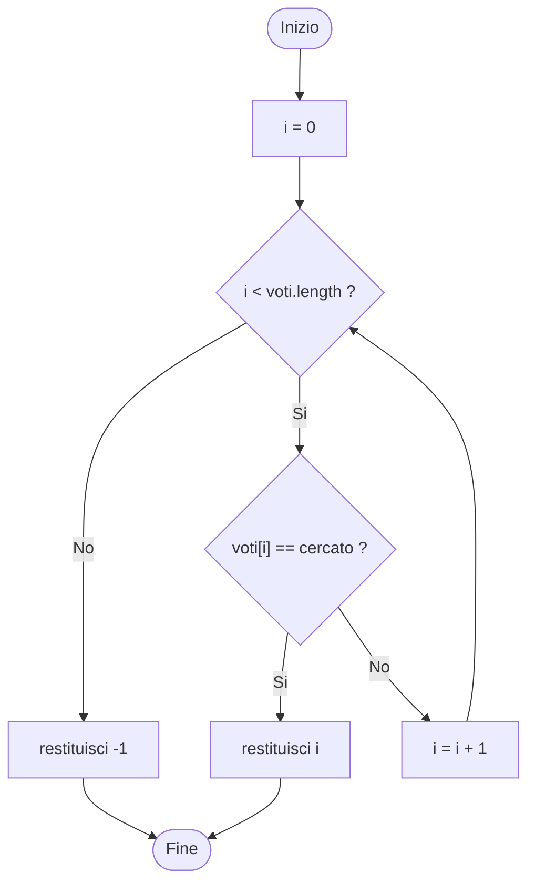

# Ricerca sequenziale su un array

La ricerca sequenziale scorre l'array dal primo elemento in avanti e confronta ogni elemento con il valore cercato. Si ferma al primo elemento uguale e restituisce il suo indice. Non richiede che l'array sia ordinato.

## Implementazione

```java
public static int cerca(int[] voti, int cercato) {
    for (int i = 0; i < voti.length; i++) {
        if (voti[i] == cercato) {
            return i;
        }
    }
    return -1;
}
```

Con l'array `{7, 6, 8, 5, 9}` e il valore `8` il metodo restituisce `2`.

## Diagramma di flusso



## Elemento non presente

Se il valore non compare nell'array, la condizione `voti[i] == cercato` non è mai vera. Il ciclo arriva alla fine dell'array, la condizione `i < voti.length` diventa falsa e il metodo restituisce `-1`. Il valore `-1` è un segnale convenzionale, perché nessun indice valido è negativo: chi chiama il metodo deve controllarlo prima di usarlo come indice.
